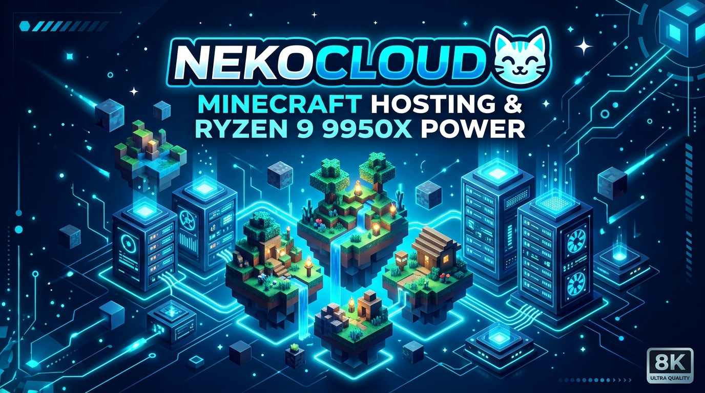

# ☁️ NekoCloud V2 — Next-Gen Minecraft & Cloud Hosting

<p align="center">
  
</p>

<p align="center">
  
  
  
  
  
</p>

---

## 💡 Sobre o Projeto & Aprendizado

A **NekoCloud V2** é uma landing page moderna de alto impacto para serviços de hospedagem de servidores **Minecraft**, instâncias **VPS Cloud KVM** e servidores dedicados **Bare Metal**, equipada conceitualmente com processadores **AMD Ryzen 9 9950X (Zen 5)** e mitigação **Anti-DDoS de 228 Tbps**.

> 🎓 **Projeto de Estudo e Aprendizado:**  
> Este projeto foi desenvolvido com finalidade educacional e para portfólio prático, demonstrando a implementação das tecnologias mais recentes da web:
> - **Next.js 16 (App Router)** com compilação ultra rápida via **Turbopack**.
> - **React 19** com componentes modernos e tipagem estrita com **TypeScript**.
> - Sistema dinâmico de temas (**Tema Claro em Branco e Azul** / **Tema Noturno em Deep Navy e Azul Neon**) com alternador instantâneo e persistência local.
> - Suporte a **OpenGraph e Twitter Cards** de alta resolução para pré-visualização no Discord e redes sociais.

---

## 🔓 Licença MIT — Código 100% Livre para Uso!

Este repositório está sob a licença **MIT**. Isso significa que:

- ✅ **Qualquer pessoa é totalmente livre para usar este projeto.**
- ✅ Você pode clonar, modificar, distribuir, estudar, adicionar novas features ou utilizar como base para sua própria landing page de hospedagem ou portfólio.
- ✅ Pode ser usado tanto para projetos pessoais quanto para projetos comerciais.
- ✅ Sinta-se à vontade para abrir *Pull Requests* e contribuir com melhorias!

Consulte o arquivo [LICENSE](./LICENSE) para mais detalhes legais.

---

## 🚀 Páginas e Recursos Implementados

| Rota | Descrição |
|---|---|
| [`/`](https://github.com/LukeX404/NekoCloudV2) | **Página Inicial:** Hero dinâmico, seletor de versões 1-clique, teste de latência e IP, planos Minecraft, diferenciais, depoimentos e FAQ. |
| [`/minecraft`](https://github.com/LukeX404/NekoCloudV2) | **Minecraft Hosting:** Planos Madeira a Netherita (2GB a 64GB RAM DDR5), suporte a GeyserMC Bedrock e Java 1.8 a 1.21.x. |
| [`/vps`](https://github.com/LukeX404/NekoCloudV2) | **VPS Cloud KVM:** Planos Start a Enterprise com Ryzen 9 9950X, seletor de SO (Ubuntu, Debian, AlmaLinux, Windows Server) e ciclo com 15% OFF. |
| [`/bare-metal`](https://github.com/LukeX404/NekoCloudV2) | **Bare Metal Dedicados:** Servidores 100% dedicados (Ryzen 7 7700X, Ryzen 9 9950X e AMD EPYC 9354) com IPMI e Anti-DDoS corporativo. |
| [`/login`](https://github.com/LukeX404/NekoCloudV2) | **Área do Cliente Demonstrativa:** Tela de login conceitual com botões sociais via **Google** e **Steam**. |

---

## 🛠️ Como Executar Localmente

```bash
# 1. Clone o repositório
git clone https://github.com/LukeX404/NekoCloudV2.git

# 2. Acesse a pasta
cd NekoCloudV2

# 3. Instale as dependências
npm install
# ou
yarn install

# 4. Inicie o servidor local
npm run dev
# ou
yarn dev
```

Abra [http://localhost:3000](http://localhost:3000) no seu navegador.

---

## 👤 Autor

Desenvolvido por **[LukeTheNeko](https://github.com/LukeX404)**.  
Contribuições, ideias e feedbacks são sempre bem-vindos! 🚀
